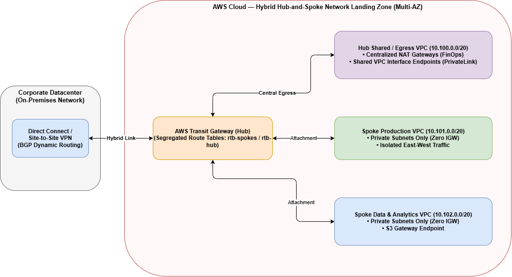

# AWS Hybrid Hub-and-Spoke Network Landing Zone (Terraform)

Blueprint corporativo de **Infrastructure as Code (Terraform)** para fundação de redes multi-VPC na AWS em topologia **Hub-and-Spoke** utilizando **AWS Transit Gateway**, roteamento segmentado (**Zero Trust**), **Centralized Egress** e **VPC Gateway Endpoints** (**FinOps**).

## Arquitetura & Documentação Técnica



* **[HLD / LLD (High-Level & Low-Level Design)](./docs/HLD-LLD-hub-spoke-landing-zone.md):** Plano de endereçamento IP (CIDR), matriz de roteamento do Transit Gateway e alta disponibilidade Multi-AZ.
* **[ADR-001 (Architecture Decision Record)](./docs/ADR-001-transit-gateway-vs-vpc-peering-mesh.md):** Justificativa técnica da escolha do Transit Gateway frente a malhas de VPC Peering.
* **[Diagrama Draw.io](./docs/architecture-diagram.drawio):** Arquivo fonte editável da topologia híbrida.

## Guardrails Embutidos (By Design)
* **Segurança & Zero Trust:** Associação e propagação padrão desativadas no Transit Gateway (`default_route_table_association = "disable"`), bloqueando tráfego lateral não autorizado entre VPCs *Spoke*; sub-redes de workloads sem Internet Gateway (IGW) direto e bloqueio de IP público automático (`map_public_ip_on_launch = false`).
* **FinOps:** Centralização de NAT Gateways na VPC Hub (evitando custos redundantes por conta/VPC), parâmetro `enable_single_nat_gateway_finops` para redução de 50% de custo em ambientes não-produtivos e provisionamento de **S3 Gateway Endpoint** gratuito na VPC de Dados.

## Como Utilizar

```bash
cd terraform
terraform init
terraform plan -var="environment=prd"
